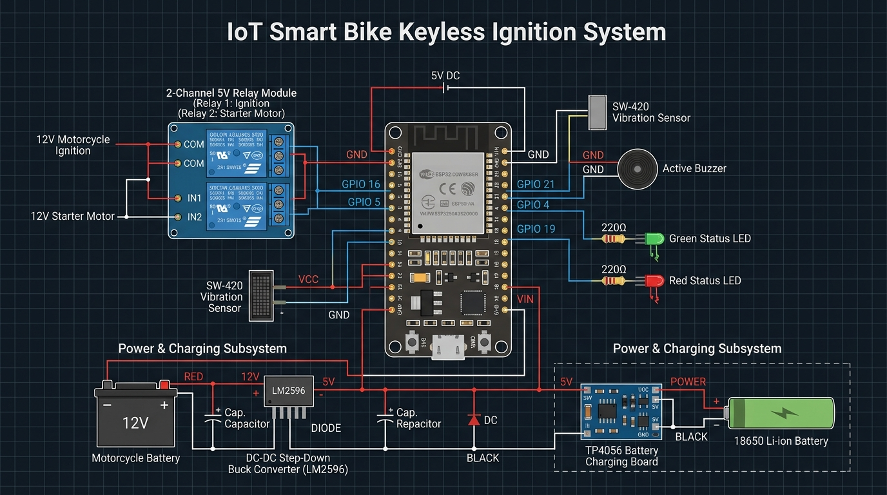

# Smart Bike Keyless System 🏍️

An IoT smart keyless ignition system for scooters and motorcycles using an **ESP32**. Features automatic Wi-Fi MAC authentication, an auto-opening Captive Portal with customizable password security, deep-sleep vibration wake-up, and an uninterruptible 18650 power/charging subsystem.

---

## 📷 Circuit & Wiring Diagram

---

## ⚡ Hardware & Pin Mapping

| Component | ESP32 Pin | Description |
| :--- | :--- | :--- |
| **Ignition Relay (Relay 1)** | `GPIO 16` | Switches the main 12V vehicle ignition circuit |
| **Starter Relay (Relay 2)** | `GPIO 5` | Fires the 12V self-starter motor line (2-second timed pulse) |
| **Buzzer** | `GPIO 4` | Auditory feedback for auth alerts, keyless lock/unlock, and locate sounds |
| **Green LED** | `GPIO 18` | Status indicator: Unlocked / Engine running (220Ω resistor) |
| **Red LED** | `GPIO 19` | Status indicator: Locked (220Ω resistor) |
| **Vibration Sensor (SW-420)**| `GPIO 21` | Hardware interrupt to wake the ESP32 from deep sleep |
| **VIN / 5V** | `VIN` | Regulated 5V input from the 18650 charging / boost board |
| **GND** | `GND` | Common ground connected across all modules |

---

## 🔋 Power & 18650 Charging Subsystem

- **Bike Battery (12V)** $\rightarrow$ **LM2596 Buck Converter** (steps down to 5.0V).
- **TP4056 Module**: Automatically charges the **18650 Li-ion battery** when the scooter is running.
- **Uninterruptible Power (UPS)**: When the scooter is turned off, the 18650 seamlessly powers the ESP32 in deep sleep, drawing negligible quiescent current.

---

## 🚀 Key Features

1. **Automatic Wi-Fi MAC Proximity Authentication**:
   - As soon as your phone connects to the **"SmartBike-Keyless"** Wi-Fi network, the ESP32 reads the connected device's MAC address.
   - If the MAC address is on the whitelist, the buzzer alerts with 3 confirmation beeps and **turns the ignition ON automatically**.
2. **Password-Protected Captive Portal**:
   - Access controls through the built-in web portal (`http://192.168.4.1`).
   - Protected with a configurable Portal Password (default: `1234`).
   - The password can be updated directly from the portal UI and persists across reboots in NVS memory.
3. **1-Click Whitelisting**:
   - No complex Bluetooth pairing or terminal tools needed.
   - Simply connect your phone to the Wi-Fi network, open the portal, and click **"+ Whitelist This Connected Phone"**.
4. **True Deep Sleep & Vibration Wake-Up**:
   - Automatically enters deep sleep after inactivity to protect the battery.
   - Wakes up instantly on physical touch/vibration via the SW-420 sensor.
5. **Real-time Vehicle Control**:
   - Turn ignition on/off, trigger the starter motor, ring the locate buzzer, and view live audit logs directly from your browser.

---

## ⚙️ Initial Setup & Usage

1. Power on the system.
2. On your smartphone, connect to the Wi-Fi network:
   - **SSID**: `SmartBike-Keyless`
   - **Password**: `kkl12345` (set in `secrets.h`)
3. Open `http://192.168.4.1` in your browser (or wait for the captive portal prompt).
4. Enter the default portal password: **`1234`**.
5. Under **"Wi-Fi Phone Whitelist"**, tap **"+ Whitelist This Connected Phone"**.
6. That's it! Every time your phone connects to the bike's Wi-Fi, it will sound confirmation beeps and turn the ignition ON automatically.
